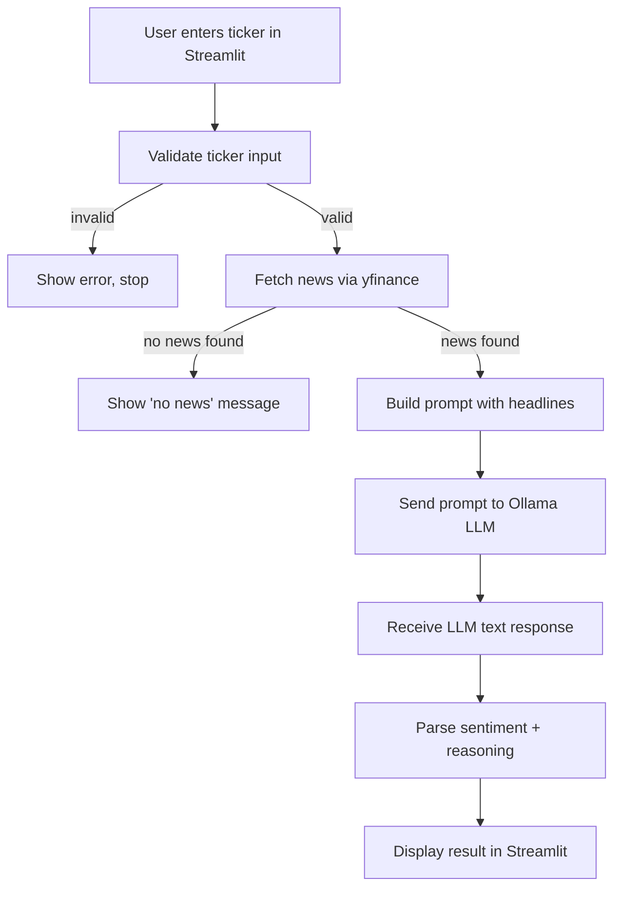

# AI Stock News & Sentiment Analyst

A small local app: enter a stock ticker, it pulls recent news headlines with `yfinance`, and a locally-running open-source LLM (`llama3.2:3b` via Ollama) returns a Positive / Negative / Neutral sentiment read with a short reason.

**Problem:** Gauging how a stock is being talked about means reading many headlines by hand. This gives a quick "gut check" for retail investors and curious learners.

> **Disclaimer:** Not financial advice. This app does not predict prices. Sentiment is based on only a handful of recent headlines and the LLM can be wrong.

## Tech stack
- LLM: `llama3.2:3b` through [Ollama](https://ollama.com) (free, local, no paid APIs, no training/fine-tuning)
- News: `yfinance` (free, no key)
- UI: Streamlit
- Dependency management: `uv`

## Setup
1. Install [Ollama](https://ollama.com/download) and start it.
2. `ollama pull llama3.2:3b`
3. Install [uv](https://docs.astral.sh/uv/getting-started/installation/), then run `uv sync`

> Moving to a new machine or Windows account? Delete `.venv/` and run `uv sync` again. The virtual environment isn't portable.

Optional sanity check that Ollama responds: `uv run python scratch_ollama.py` (the Milestone 0 script).

## Run
```
uv run streamlit run app.py
```
Open the local URL shown in the terminal.

## Tests
```
uv run pytest
```
The unit tests mock yfinance and Ollama, so they run offline. The manual end-to-end checks are recorded in [docs/e2e_test_results.md](docs/e2e_test_results.md).

## Workflow


## Project structure
| File | Role |
| --- | --- |
| `app.py` | Streamlit UI, wires the pipeline together |
| `news_fetcher.py` | Ticker validation, ticker-exists check, yfinance headlines |
| `prompt_templates.py` | Prompt builder |
| `llm_client.py` | Ollama call + friendly errors |
| `response_parser.py` | Extracts label + reasoning, falls back to "Unclear" |
| `scratch_ollama.py` | Milestone 0 check that Ollama responds |
| `tests/` | Unit tests (yfinance/Ollama mocked) |
| `docs/` | E2E test results, LLM evaluation, presentation script, screenshots |

## Example
Input: `AAPL`
Output: `Sentiment: Neutral`. *The headlines mention changes and releases, but the overall tone is not clearly positive or negative.*


## Error handling
| Situation | What the user sees |
| --- | --- |
| Empty or malformed ticker | Validation error, no network/LLM call |
| Ticker doesn't exist | "Ticker '…' not found" |
| Real ticker, no recent news | "No recent news found" |
| No internet / yfinance failure | "Couldn't fetch news right now" |
| Ollama not running | "Could not reach Ollama. Make sure the Ollama app is running." |
| Model not pulled | "Model '…' not found. Run: ollama pull …" |
| Model ignores output format | Label shown as "Unclear" with the raw reply |

## Known limitations
- Uses only ~3–10 recent headlines; not deep financial analysis.
- A 3B model may misjudge tone or occasionally ignore the output format (shown as "Unclear").
- Requires internet for yfinance and a running Ollama.
- "Ticker not found" relies on yfinance price history; if that lookup itself fails, the app falls back to the "no recent news" message.

See [docs/llm_evaluation.md](docs/llm_evaluation.md) for a human-vs-model comparison across several tickers.
