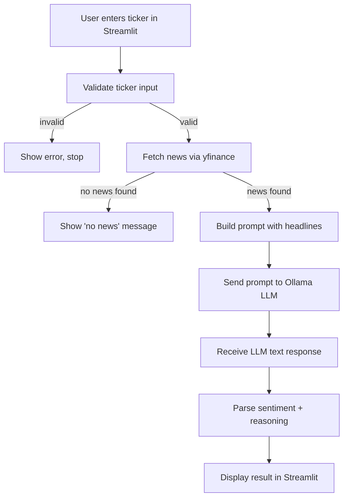

# AI Stock News & Sentiment Analyst

A small local app: enter a stock ticker, it pulls recent news headlines with `yfinance`, and a locally-running open-source LLM (`llama3.2:3b` via Ollama) returns a Positive / Negative / Neutral sentiment read with a short reason.

**Problem:** Gauging how a stock is being talked about means reading many headlines by hand. This gives a quick "gut check" for retail investors and curious learners.

> **Disclaimer:** Not financial advice. This app does not predict prices. Sentiment is based on only a handful of recent headlines and the LLM can be wrong.

## Tech stack
- LLM: `llama3.2:3b` through [Ollama](https://ollama.com) (free, local, no paid APIs, no training/fine-tuning)
- News: `yfinance` (free, no key)
- UI: Streamlit
- Dependency management: `uv`

## Setup
1. Install [Ollama](https://ollama.com/download) and start it.
2. `ollama pull llama3.2:3b`
3. `uv sync`

## Run
```
uv run streamlit run app.py
```
Open the local URL shown in the terminal.

## Tests
```
uv run pytest
```

## Workflow


## Project structure
| File | Role |
| --- | --- |
| `app.py` | Streamlit UI, wires the pipeline together |
| `news_fetcher.py` | Ticker validation + yfinance headlines |
| `prompt_templates.py` | Prompt builder |
| `llm_client.py` | Ollama call + friendly errors |
| `response_parser.py` | Extracts label + reasoning, falls back to "Unclear" |
| `tests/` | Unit tests (yfinance/Ollama mocked) |

## Example
Input: `AAPL`
Output: `Sentiment: Neutral` — *The headlines mention changes and releases, but the overall tone is not clearly positive or negative.*

## Known limitations
- Uses only ~3–10 recent headlines; not deep financial analysis.
- A 3B model may misjudge tone or occasionally ignore the output format (shown as "Unclear").
- Requires internet for yfinance and a running Ollama.
