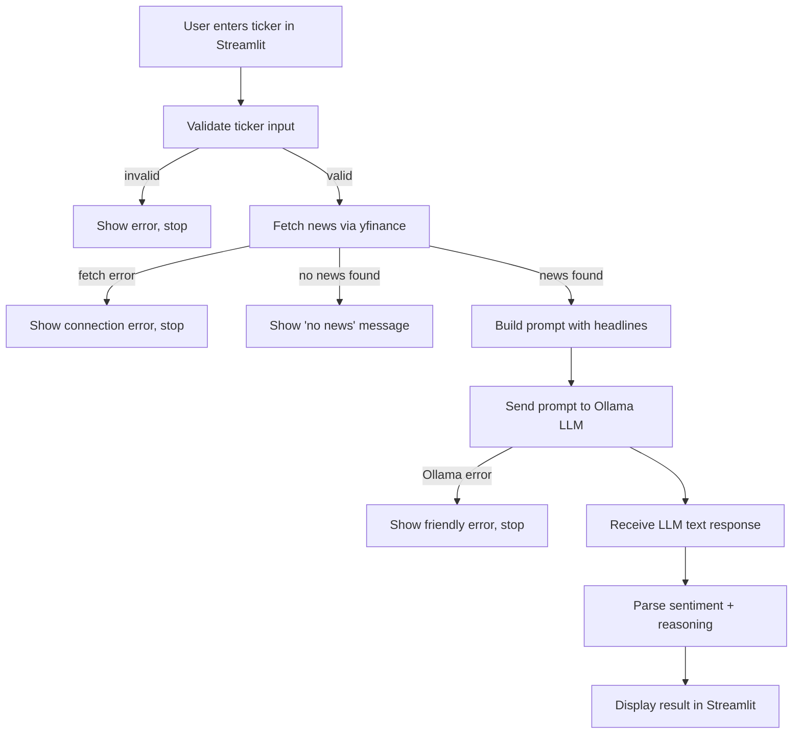

# Architecture

The app is a linear pipeline of small modules. Each module has one job, and errors are handled where they happen, then shown as friendly messages in the UI.

## Data flow

## Modules

| Module | Responsibility | Key functions |
| --- | --- | --- |
| `app.py` | Streamlit UI. Collects input, runs the pipeline, renders results or errors. | n/a |
| `news_fetcher.py` | Validates the ticker and fetches headlines from `yfinance`. | `is_valid_ticker`, `get_headlines` |
| `prompt_templates.py` | Builds the prompt from the ticker and headlines. | `build_prompt`, `clean_headline` |
| `llm_client.py` | Calls the local Ollama model and converts failures into friendly errors. | `ask_llm`, `LLMError` |
| `response_parser.py` | Extracts the sentiment label and reasoning from the raw reply. | `parse_sentiment` |

## Error handling

Each boundary raises or returns a specific result, and `app.py` decides what the user sees.

| Situation | Where it's detected | What the user sees |
| --- | --- | --- |
| Empty or malformed ticker | `is_valid_ticker` | "Please enter a valid ticker symbol" |
| Network or API failure | `get_headlines` raises `NewsFetchError` | "Couldn't fetch news right now" |
| Unknown ticker or no news | `get_headlines` returns an empty list | "No news found for ..." |
| Ollama not running | `ask_llm` raises `LLMError` | "Could not reach Ollama" |
| Model not downloaded | `ask_llm` raises `LLMError` (HTTP 404) | "Model ... not found. Run: ollama pull ..." |
| Other model failure or timeout | `ask_llm` raises `LLMError` | "Could not get a response from the local model" |
| Reply ignores the format | `parse_sentiment` returns `Unclear` | "Unclear" label with the raw reply shown |

No raw stack trace reaches the user.

## Design decisions

- **Local model:** `llama3.2:3b` runs through Ollama, so there are no API keys, no per-request cost, and headlines are processed on the user's machine.
- **No training:** The app uses a pre-trained model. It does not train or fine-tune anything.
- **Validation first:** `is_valid_ticker` rejects bad input before spending a network call or a model call.
- **Parser fallback:** A 3B model sometimes ignores the requested format, so the parser returns `Unclear` and shows the raw text.
- **Isolated dependencies:** Only `news_fetcher.py` and `llm_client.py` talk to external systems. This keeps them easy to mock in tests.

## Out of scope

Price prediction, portfolio tracking, multi-ticker comparison, historical sentiment, and any persistent storage.
